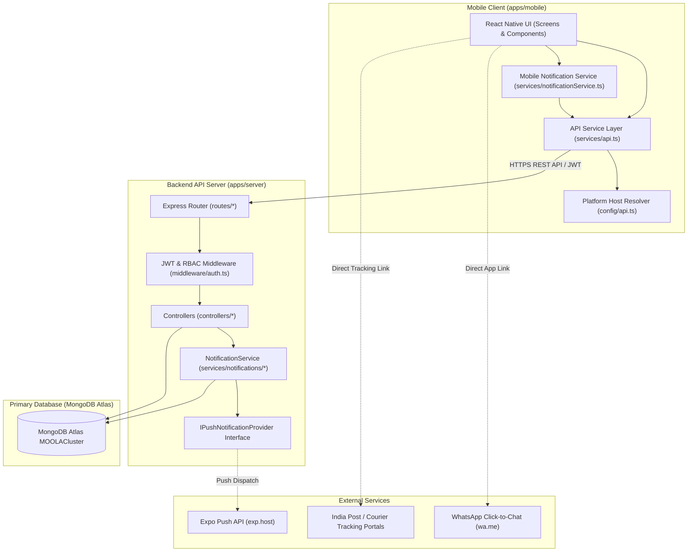
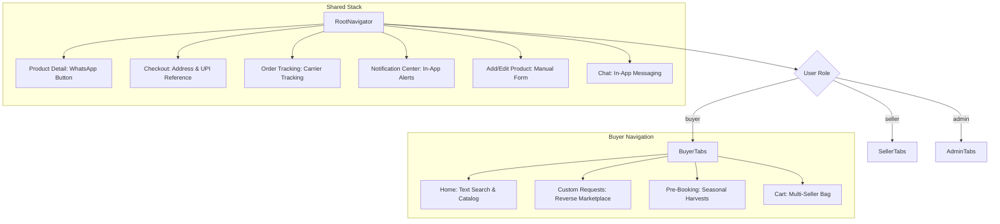
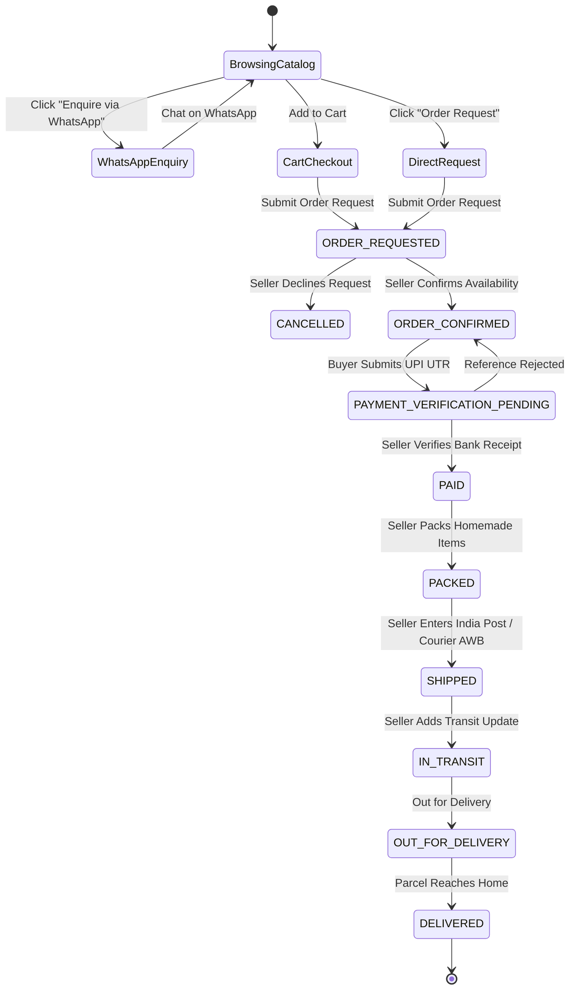

# MOOLA — From the Source. To Your Home.
### Organic Food & Homemade Products Direct-to-Consumer (D2C) Marketplace


> **Provisional Brand**: MOOLA (*From the Source. To Your Home.*)  
> **Source Blueprint**: `organic_marketplace_blueprint (1).pdf`  
> **Architecture**: React Native (Expo SDK 51) Mobile App + Node.js/Express REST API + MongoDB Atlas Primary Database + Shared TypeScript Monorepo  

---

## Table of Contents
1. [Project Overview](#1-project-overview)
2. [Business Objectives & Product Scope](#2-business-objectives--product-scope)
3. [Current Implemented Features](#3-current-implemented-features)
4. [Explicitly Excluded or Unfinished Features](#4-explicitly-excluded-or-unfinished-features)
5. [Technology Stack](#5-technology-stack)
6. [Architecture Overview & Mermaid Diagrams](#6-architecture-overview--mermaid-diagrams)
7. [Complete Repository Folder Tree](#7-complete-repository-folder-tree)
8. [Responsibilities of Key Folders and Files](#8-responsibilities-of-key-folders-and-files)
9. [Frontend Architecture & Navigation](#9-frontend-architecture--navigation)
10. [Backend Architecture & Controller Responsibilities](#10-backend-architecture--controller-responsibilities)
11. [Database Architecture & Model Relationships](#11-database-architecture--model-relationships)
12. [Authentication, Authorization & Role Control](#12-authentication-authorization--role-control)
13. [API Architecture & Endpoint Reference](#13-api-architecture--endpoint-reference)
14. [Product, Enquiry, Order & Shipment Workflows](#14-product-enquiry-order--shipment-workflows)
15. [WhatsApp Click-to-Chat Integration](#15-whatsapp-click-to-chat-integration)
16. [Manual Courier & India Post Tracking](#16-manual-courier--india-post-tracking)
17. [Notification Architecture (MongoDB Atlas & Expo Push)](#17-notification-architecture-mongodb-atlas--expo-push)
18. [Image Storage Architecture](#18-image-storage-architecture)
19. [Environment Variables Reference](#19-environment-variables-reference)
20. [MongoDB Atlas Setup Instructions](#20-mongodb-atlas-setup-instructions)
21. [Installation & Setup Commands](#21-installation--setup-commands)
22. [Mobile Application Development Guide](#22-mobile-application-development-guide)
23. [Backend API Development Guide](#23-backend-api-development-guide)
24. [Database Connection Verification](#24-database-connection-verification)
25. [Testing, Linting, & Build Commands](#25-testing-linting--build-commands)
    - [25.1 Customer Support, Legal Compliance & Account Deletion](#251-customer-support-legal-compliance--account-deletion-architecture)
26. [Debugging & Common Troubleshooting](#26-debugging--common-troubleshooting)
27. [Security Practices & Data Protection](#27-security-practices--data-protection)
28. [Development, Staging & Production Configuration](#28-development-staging--production-configuration)
29. [Deployment Preparation & Operational Backups](#29-deployment-preparation--operational-backups)
30. [Known Limitations & Technical Debt](#30-known-limitations--technical-debt)
31. [Developer Extension Guides (How to Add Features)](#31-developer-extension-guides-how-to-add-features)
32. [References & Supporting Documentation](#32-references--supporting-documentation)

---

## 1. Project Overview

**MOOLA** is a Direct-to-Consumer (D2C) organic food and homemade products marketplace connecting rural farmers, traditional food artisans, and organic producers across India directly with urban and regional consumers.

The platform eliminates intermediaries, ensuring that makers receive fair remuneration while buyers obtain authenticated, chemical-free homemade products with transparent origin traceability.

---

## 2. Business Objectives & Product Scope

### What MOOLA Sells:
- **Homemade Chips & Crisps**: Traditional jackfruit chips, Kerala Nendran banana chips in pure cold-pressed coconut oil, tapioca crisps.
- **Raw Forest & Farm Honey**: Western Ghats wild multi-flora honey, unpasteurized apiary honey, comb honey.
- **Native Spices & Masala Powders**: Malabar black pepper, Coorg green cardamom, Wayanad cinnamon, traditional sambar/rasam blends.
- **Authentic Homemade Pickles**: Malnad Appe Midi raw mango pickle, tender bamboo shoot pickle, traditional lemon-chilli pickles.
- **Traditional Handmade Food Products**: Palm jaggery, hand-pounded red rice, native millets, handmade festive snacks.

> [!IMPORTANT]
> **MOOLA IS NOT A VEGETABLE MARKETPLACE.**  
> MOOLA is specifically designed for homemade, artisanal, and shelf-stable or semi-perishable organic specialty products. It is not designed or architected around rapid-spoilage fresh green vegetable deliveries.

---

## 3. Current Implemented Features

### Buyer & Consumer Experience:
- **Product Discovery**: Browse by category (chips, honey, spices, pickles, snacks) with English and Kannada localization.
- **Full-Text Text Search**: Live search backed by MongoDB Atlas compound text indexes.
- **Product Details & Badges**: Transparent seller details, pricing, units, organic certification badges, and gallery previews.
- **WhatsApp Direct Enquiry**: Official click-to-chat (`wa.me`) link generation with prefilled product, quantity, and price details.
- **Cart & Direct Order Requests**: Add items to cart or request single products directly.
- **Immutable Order Snapshots**: Order lines store permanent snapshots of product state at checkout time.
- **Payment Reference Submission**: Submit UPI transaction reference (UTR) for independent seller verification.
- **Courier & Postal Tracking**: View seller-provided carrier name (India Post, DTDC, Blue Dart, etc.), consignment number, dispatch date, and trusted tracking links.
- **In-App Notification Center**: View unread counts, mark notifications read, filter by category (All, Orders, Shipments), pull-to-refresh.
- **Customer Support Hub**: Fast direct dial and WhatsApp links for both dedicated support helplines (`+91 80886 53820` and `+91 63620 95126`).
- **In-App Complaint Submission**: Submit tickets with category, subject, description, optional order reference, and priority. Unique reference ID (`TKT-YYYYMMDD-XXXX`) generated on server.
- **My Complaints Tracking**: Live tracking of user's own tickets (`SUBMITTED`, `ACKNOWLEDGED`, `UNDER_REVIEW`, `RESOLVED`, `CLOSED`), status history timeline, and public developer updates.
- **Privacy Policy & Terms In-App**: Easily readable screens with clear typography, audited data disclosures, and 16 business workflow sections.
- **In-App Account Deletion**: Submit authenticated deletion request with consequence disclosures, active order checking, and status tracking.

### Seller Experience:
- **Seller Profile & KYC**: Submit shop name, description, WhatsApp number, UPI ID, payment instructions, and identity/FSSAI documents.
- **Manual Product Management**: Create, edit, and deactivate listings with the manual listing screen (`AddProductScreen.tsx`).
- **Order Management**: Review incoming order requests, confirm availability or decline with reason.
- **Independent Payment Verification**: Review buyer UPI references and verify receipt before parcel dispatch.
- **Manual Consignment Dispatch**: Record courier service, AWB/consignment number, dispatch date, notes, and progress updates.
- **Seller Support & Account Deletion**: Access dedicated support lines, file tickets, or request store deactivation and account deletion.

### Admin Experience (For the Two Developers):
- **Platform Analytics**: Total users, verified sellers, pending KYC count, catalog size, and total platform revenue.
- **KYC Moderation**: Review submitted documents, approve sellers, or reject with feedback.
- **Catalog Moderation**: Delist products violating marketplace guidelines with automatic seller notification.
- **Support Tickets Management**: Tab in `AdminDashboardScreen` with ticket search, status filters (`ALL`, `SUBMITTED`, `UNDER_REVIEW`, `RESOLVED`, `OVERDUE`), private internal notes log, public replies, and status transitions.
- **SLA Response Deadline Tracking**: 48-hour response target flags overdue tickets automatically.
- **Account Deletion Queue**: Review pending requests, verify active orders, force complete (deactivate, revoke tokens, anonymize personal details, close seller store), or reject with reason.

### Public Web Experience (Play Store Compliance):
- **Direct HTTPS Webpages**: Responsive static web pages served directly from Express at `/public/`:
  - `/privacy-policy`: Official Privacy Policy with audited data practices.
  - `/terms-and-conditions`: Complete 16-section marketplace Terms & Conditions.
  - `/account-deletion`: Public account deletion request portal for users unable to log in.
  - `/support`: Customer support landing page with direct call and WhatsApp actions for both numbers.
  - `/`: MOOLA Legal & Support Portal home.

---

## 4. Explicitly Excluded or Unfinished Features

- **No Active Bank Details or Bank-Payment Workflows**: Bank account numbers, IFSC codes, bank account forms, seller bank detail pages, and direct bank transfer instructions are strictly removed from the active user experience in this release. Payment relies on verified UPI transaction reference submission (UTR) and direct WhatsApp seller confirmation.
- **No Unrestricted Role Escalation**: Buyers cannot elevate themselves to sellers via buttons or client payloads. Becoming a seller requires submitting an onboarding application reviewed and approved by an administrator on the backend.
- **No AI Voice Features**: AI voice product listing, speech-to-text product creation, and voice search are explicitly excluded from this release.
- **No Premature Payment Gateway**: Automatic credit card/net-banking gateways (e.g. Razorpay automated charging) are intentionally not engaged in this version to preserve direct buyer-seller trust via WhatsApp negotiation and verified UPI payment.
- **No Automated Logistics APIs**: Shiprocket and Delhivery automated carrier APIs are omitted in this version; manual consignment dispatch with trusted carrier links (India Post, DTDC, etc.) is implemented instead.
- **No Firebase Authentication or Database**: MongoDB Atlas is the exclusive primary database.

---

## 5. Technology Stack

| Layer | Technologies |
| :--- | :--- |
| **Mobile Frontend** | React Native 0.74, Expo SDK 51, TypeScript 5.3, React Navigation v6, Lucide/Vector Icons, Safe Area Context |
| **Backend API** | Node.js 20+, Express.js 4.19, TypeScript 5.3, Helmet, CORS, Morgan, Zod 3.23, Rate-Limiter |
| **Database** | MongoDB Atlas (`MOOLACluster`), Mongoose 8.4 ODM |
| **Shared Package** | `@moola/shared` (TypeScript types, enums, constants, URL generators) |
| **Push Notifications** | Abstracted `IPushNotificationProvider`, `ExpoPushNotificationProvider` (`https://exp.host/--/api/v2/push/send`) |
| **Real-time / Sockets** | Socket.io 4.7 (chat and live notification transport) |
| **Testing** | Jest 29, Supertest 7, ts-jest |

---

## 6. Architecture Overview & Mermaid Diagrams



---

## 7. Complete Repository Folder Tree

```
d:/Moola-App/
├── .gitignore
├── package.json
├── package-lock.json
├── moola logo.png
├── organic_marketplace_blueprint (1).pdf
├── apps/
│   ├── mobile/
│   │   ├── app.json
│   │   ├── App.tsx
│   │   ├── index.ts
│   │   ├── package.json
│   │   ├── tsconfig.json
│   │   ├── assets/
│   │   │   ├── favicon.png
│   │   │   ├── icon.png
│   │   │   ├── logo.png
│   │   │   └── splash.png
│   │   └── src/
│   │       ├── components/
│   │       │   ├── Header.tsx
│   │       │   ├── ProductCard.tsx
│   │       │   └── TimelineTracker.tsx
│   │       ├── config/
│   │       │   └── api.ts
│   │       ├── context/
│   │       │   ├── AuthContext.tsx
│   │       │   ├── CartContext.tsx
│   │       │   └── LanguageContext.tsx
│   │       ├── localization/
│   │       │   └── i18n.ts
│   │       ├── navigation/
│   │       │   └── RootNavigator.tsx
│   │       ├── screens/
│   │       │   ├── admin/
│   │       │   │   └── AdminDashboardScreen.tsx
│   │       │   ├── auth/
│   │       │   │   └── WelcomeScreen.tsx
│   │       │   ├── buyer/
│   │       │   │   ├── CartScreen.tsx
│   │       │   │   ├── ChatScreen.tsx
│   │       │   │   ├── CheckoutScreen.tsx
│   │       │   │   ├── CustomRequestsScreen.tsx
│   │       │   │   ├── HomeScreen.tsx
│   │       │   │   ├── NewCustomRequestScreen.tsx
│   │       │   │   ├── NotificationsScreen.tsx
│   │       │   │   ├── OrderTrackingScreen.tsx
│   │       │   │   ├── PreBookingScreen.tsx
│   │       │   │   └── ProductDetailScreen.tsx
│   │       │   └── seller/
│   │       │       ├── AddProductScreen.tsx
│   │       │       ├── SellerDashboardScreen.tsx
│   │       │       ├── SellerKYCScreen.tsx
│   │       │       └── SellerOrdersScreen.tsx
│   │       ├── services/
│   │       │   ├── api.ts
│   │       │   ├── mockData.ts
│   │       │   └── notificationService.ts
│   │       └── theme/
│   │           └── colors.ts
│   └── server/
│       ├── .env.example
│       ├── jest.config.json
│       ├── nodemon.json
│       ├── package.json
│       ├── tsconfig.json
│       └── src/
│           ├── app.ts
│           ├── index.ts
│           ├── config/
│           │   ├── database.ts
│           │   └── env.ts
│           ├── controllers/
│           │   ├── adminController.ts
│           │   ├── authController.ts
│           │   ├── enquiryController.ts
│           │   ├── index.ts
│           │   ├── notificationController.ts
│           │   ├── orderController.ts
│           │   ├── paymentController.ts
│           │   ├── productController.ts
│           │   └── shipmentController.ts
│           ├── middleware/
│           │   ├── auth.ts
│           │   ├── errorHandler.ts
│           │   └── rateLimiter.ts
│           ├── models/
│           │   ├── Buyer.ts
│           │   ├── Campaign.ts
│           │   ├── Category.ts
│           │   ├── Chat.ts
│           │   ├── CustomRequest.ts
│           │   ├── Notification.ts
│           │   ├── Order.ts
│           │   ├── Payment.ts
│           │   ├── Product.ts
│           │   ├── Review.ts
│           │   ├── SellerProfile.ts
│           │   ├── Shipment.ts
│           │   ├── User.ts
│           │   └── WhatsAppEnquiry.ts
│           ├── routes/
│           │   ├── admin.ts
│           │   ├── auth.ts
│           │   ├── buyer.ts
│           │   ├── campaigns.ts
│           │   ├── conversations.ts
│           │   ├── customRequests.ts
│           │   ├── enquiries.ts
│           │   ├── health.ts
│           │   ├── notifications.ts
│           │   ├── orders.ts
│           │   ├── payments.ts
│           │   ├── products.ts
│           │   ├── reviews.ts
│           │   ├── seller.ts
│           │   └── shipments.ts
│           ├── scripts/
│           │   └── seed.ts
│           ├── services/
│           │   └── notifications/
│           │       ├── expoPushProvider.ts
│           │       ├── mockPushProvider.ts
│           │       ├── notificationService.ts
│           │       └── pushProvider.interface.ts
│           ├── sockets/
│           │   └── chat.ts
│           └── tests/
│               ├── health.test.ts
│               ├── notifications.test.ts
│               ├── setup.ts
│               └── workflow.test.ts
├── docs/
│   ├── ARCHITECTURE.md
│   ├── DEVELOPMENT.md
│   ├── logo.png
│   ├── PROGRESS.md
│   ├── PROJECT_AUDIT.md
│   ├── PROJECT_PLAN.md
│   └── ROADMAP.md
└── packages/
    └── shared/
        ├── package.json
        ├── tsconfig.json
        └── src/
            └── index.ts
```

---

## 8. Responsibilities of Key Folders and Files

- **`packages/shared/src/index.ts`**: The canonical TypeScript single source of truth for interfaces (`Product`, `Order`, `Shipment`, `Notification`), status enums (`OrderStatus`, `PaymentStatus`, `ShipmentStatus`), carrier configurations, and helper functions.
- **`apps/server/src/controllers/`**: Controller layer containing all business rules, database queries, stock deductions, snapshot generations, state transitions, and notification triggers.
- **`apps/server/src/routes/`**: Declarative route maps connecting HTTP endpoints to controller handlers with authentication and role authorization middleware.
- **`apps/server/src/services/notifications/notificationService.ts`**: Centralized notification dispatcher that guarantees in-app notification persistence in MongoDB Atlas first, then optionally delivers push notifications.
- **`apps/mobile/src/config/api.ts`**: Platform-aware host detector ensuring Android emulator (`10.0.2.2`), iOS simulator, and production endpoints work seamlessly.
- **`apps/mobile/src/services/api.ts`**: Typed, domain-grouped mobile API client with built-in timeouts and offline error resilience.
- **`apps/mobile/src/screens/seller/AddProductScreen.tsx`**: Manual product listing interface for farmers and homemade product makers.

---

## 9. Frontend Architecture & Navigation

MOOLA uses a role-based navigation hierarchy driven by `AuthContext`:



---

## 10. Backend Architecture & Controller Responsibilities

| Controller | File Path | Primary Responsibilities |
| :--- | :--- | :--- |
| `OrderController` | `controllers/orderController.ts` | Multi-seller cart order creation, direct single-item order requests, immutable snapshot creation, state transition validation, seller confirmation/declining, cancellation. |
| `ShipmentController` | `controllers/shipmentController.ts` | Manual consignment registration, trusted carrier link generation, tracking history updates, carrier template lookup. |
| `PaymentController` | `controllers/paymentController.ts` | Seller payment instructions, buyer payment reference (UTR) submission, seller independent payment verification. |
| `EnquiryController` | `controllers/enquiryController.ts` | Product enquiry validation, seller WhatsApp number normalization, `wa.me` URL generation, MongoDB enquiry logging. |
| `NotificationController`| `controllers/notificationController.ts`| Paginated in-app notification retrieval, unread count badge calculation, read status updates, push token registration. |
| `ProductController` | `controllers/productController.ts` | Compound full-text search, category filtering, seller product listing, updates with automatic re-moderation trigger. |
| `AuthController` | `controllers/authController.ts` | Phone/password registration, bcrypt authentication, JWT token pair issuance, refresh token rotation. |
| `AdminController` | `controllers/adminController.ts` | Platform revenue aggregation, seller KYC review & verification, catalog moderation. |
| `ComplaintController` | `controllers/complaintController.ts` | User complaint registration, unique ticket ID generation, user ticket status retrieval, admin ticket listing, private developer internal notes, public customer responses, SLA deadline tracking. |
| `AccountDeletionController` | `controllers/accountDeletionController.ts` | In-app authenticated account deletion requests, public website verification requests, active orders integrity checks, session and token revocation, user personal data anonymization, and seller listing deactivation. |

---

## 11. Database Architecture & Model Relationships

1. **User (`User.ts`)**: Base identity model for all roles (`buyer`, `seller`, `admin`). Contains phone, email, bcrypt `passwordHash`, `pushTokens` array, preferred language (`en`/`kn`), and active status.
2. **SellerProfile (`SellerProfile.ts`)**: 1-to-1 extension of `User` for sellers. Contains `shopName`, `kycStatus`, `whatsappNumber`, `upiId`, `paymentInstructions`, and rating statistics.
3. **Product (`Product.ts`)**: Categorized products with bilingual `name` and `description` (`{ en: string, kn: string }`), pricing, available quantity, organic certification badge, and compound full-text index.
4. **Order (`Order.ts`)**: Orders placed by buyers. Contains order items with permanent snapshots (`OrderItemSnapshot`), decoupled payment and shipment status, delivery address, and status history log.
5. **Payment (`Payment.ts`)**: 1-to-1 with `Order`. Records payment reference (UTR), seller instructions, verified timestamp, and extensible fields for future payment gateway integrations.
6. **Shipment (`Shipment.ts`)**: 1-to-1 with `Order`. Records carrier name, consignment number, dispatch date, generated tracking URL, dispatch notes, and seller tracking timeline updates.
7. **WhatsAppEnquiry (`WhatsAppEnquiry.ts`)**: Auditable click-to-chat log recording buyer intent, seller phone, prefilled message, and enquiry lifecycle status.
8. **Notification (`Notification.ts`)**: MongoDB Atlas in-app notification documents with 90-day TTL index, read status, and push delivery status.
9. **Complaint (`Complaint.ts`)**: Unique ticket ID (`TKT-YYYYMMDD-XXXX`), references `userId` and optional `orderId`, category, status history log, private developer internal notes array (isolated from user projections), and 48-hour SLA deadline index.
10. **AccountDeletionRequest (`AccountDeletionRequest.ts`)**: Unique request ID (`DEL-YYYYMMDD-XXXX`), references `userId`, verification state (`authenticated_session` vs `web_requested_pending_verification`), active orders count, completion/rejection notes, and private administrator audit notes.

---

## 12. Authentication, Authorization & Role Control

### Public User Roles & Strict Separation

The public MOOLA application enforces strict role separation with server-side access controls:

1. **Buyer**:
   - Discovers homemade products, performs full-text search, and browses categories.
   - Directly contacts makers via WhatsApp with pre-filled enquiry details.
   - Submits order requests and submits verified UPI transaction references (UTR).
   - Tracks parcel shipments via India Post or courier consignment numbers.
   - Files support tickets and tracks resolution timelines.
   - Submits authenticated account deletion requests.
   - **Restriction**: Cannot access seller management screens, cannot call `/api/v1/seller/*` or `/api/v1/products/my`, and cannot self-assign seller privileges.

2. **Seller**:
   - Manages store profile, artisanal bio, UPI ID, and payment instructions.
   - Creates, edits, and manages homemade food listings (`POST /api/v1/products`).
   - Reviews incoming buyer orders, confirms availability, and marks orders dispatched.
   - Submits India Post / DTDC consignment tracking details.
   - Accesses seller-scoped sales and customer enquiry metrics.
   - **Restriction**: Scoped strictly to their own listings and orders. Cannot modify another seller's products or access administrator endpoints.

3. **Administrator (Limited Operational Role)**:
   - Manages platform buyers and sellers, moderates product listings, reviews seller applications, resolves customer complaints, and processes account deletion requests.
   - Access is restricted to designated administrators; self-registration and privilege escalation are strictly forbidden.

### Seller Application & Admin Review Flow

To prevent unauthorized buyer-to-seller escalation, MOOLA implements an explicit onboarding pipeline:

```
[Buyer Account] ──► Submits Application (POST /api/v1/seller/apply)
                          │
                          ▼
            [SellerProfile: status='pending']
            (User remains 'buyer' role on server)
                          │
                          ▼
       [Admin Reviews in Admin Dashboard] (GET /api/v1/admin/sellers)
                          │
           ┌──────────────┴──────────────┐
           ▼                             ▼
       [APPROVE]                     [REJECT]
User.role promoted to 'seller'    User.role retained as 'buyer'
SellerProfile: 'verified'         Rejection reason stored for user
```

1. **Submission**: Authenticated buyers submit their shop name, description, WhatsApp number, and artisanal specialty via `POST /api/v1/seller/apply`.
2. **Pending Review**: The server creates a `SellerProfile` with `kycStatus: 'pending'`. The user's role remains strictly `buyer`.
3. **Artisan Verification**: Sellers can optionally provide FSSAI registration numbers or organic certificates via `POST /api/v1/seller/kyc` (bank details are explicitly excluded).
4. **Administrative Decision**: An administrator reviews the application. Calling `POST /api/v1/admin/sellers/:id/kyc` with action `verified` promotes the user to `role = 'seller'`. If rejected, the reason is logged and the user remains a `buyer`.
5. **No Client Role-Switching**: All client-side role toggle buttons have been eliminated. UI displays role-aware badges ("Sell on MOOLA" for buyers, verified shop badge for sellers, admin badge for administrators).

### Private Administrator Security & Zero-Trust Architecture
Admin functionality is strictly isolated from ordinary public navigation and secured for the designated system administrators:
- **Public Admin Registration Rejection**: The registration endpoint (`POST /api/v1/auth/register`) rejects any payload requesting `role: 'admin'` with HTTP 403 (`ADMIN_REGISTRATION_FORBIDDEN`). Public role schemas strictly allow `['buyer', 'seller']`.
- **Role Escalation Prevention**: `PATCH /api/v1/auth/me` excludes the `role` field from update schemas, preventing any authenticated user from elevating privileges.
- **Backend Authorization Enforcement**: Every endpoint under `/api/v1/admin/*` enforces `authenticate` and `authorize('admin')`. Tokens belonging to Buyers or Sellers receive immediate HTTP 403 Forbidden.
- **Controlled Admin Provisioning CLI**: Administrator accounts cannot be created via the web or mobile app. They are provisioned server-side using a protected CLI tool:
  ```bash
  # From apps/server:
  npm run admin:provision -- --phone 9000000000 --password "SecureAdminPassword" --name "Lead Administrator"
  ```
  The script validates phone numbers against `ADMIN_ALLOWED_PHONES` configured in `.env`, hashes credentials with bcrypt (12 rounds), and safely upgrades or creates the admin account.

- **Password Security**: Hashed using `bcryptjs` with 12 salt rounds in a Mongoose pre-save hook. Passwords and hashes are never returned in API payloads (`select: false`).
- **JWT Authentication**:
  - `accessToken`: Short-lived (15 minutes), passed via `Authorization: Bearer <token>`.
  - `refreshToken`: Long-lived (7 days), stored securely and rotated on each refresh.
- **Ownership Scoping**: Buyers cannot access seller order lists or private seller data. Sellers cannot access another seller's products, incoming orders, or customer complaints.

---

## 13. API Architecture & Endpoint Reference

Base URL: `/api/v1`

### Authentication & Profile (`/api/v1/auth`)
- `POST /register`: Register new public user (`name`, `phone`, `password`, `role: 'buyer' | 'seller'`, optional `shopName`). Rejects `admin`.
- `POST /login`: Authenticate with phone and password.
- `POST /refresh`: Exchange valid refresh token for a new token pair.
- `POST /logout`: Revoke refresh token.
- `GET /me`: Get current authenticated user and profile.
- `PATCH /me`: Update profile details (role escalation strictly blocked).
- `POST /fcm-token`: Register device push notification token.

### Seller Onboarding & Store Profile (`/api/v1/seller`)
- `POST /apply`: Authenticated buyer submits application to become a seller (`shopName`, `description`, `whatsappNumber`, `craftSpecialty`).
- `GET /application-status`: Retrieve current user's seller application status and review state.
- `GET /profile`: Retrieve authenticated seller's store profile.
- `PATCH /profile`: Update store description, UPI ID, and payment instructions.
- `POST /kyc`: Submit FSSAI or Organic Food Artisan certification credentials (bank details strictly excluded).
- `GET /earnings`: Retrieve store earnings, order volume, and revenue metrics.

### Products (`/api/v1/products`)
- `GET /`: Search and list products (`q`, `category`, `minPrice`, `maxPrice`, `isOrganic`, `page`, `limit`).
- `GET /my`: Seller retrieves their own products.
- `GET /:id`: Retrieve single product and seller information.
- `POST /`: Verified seller lists a new product.
- `PATCH /:id`: Seller or admin updates product listing.
- `DELETE /:id`: Deactivate product listing (soft delete).

### Orders (`/api/v1/orders`)
- `POST /`: Create orders from cart (grouped by seller with snapshots).
- `POST /request`: Direct single-product order request without cart.
- `GET /my`: Buyer retrieves order history.
- `GET /seller`: Seller retrieves incoming orders.
- `GET /:id`: Retrieve detailed order by ID.
- `POST /:id/confirm`: Seller confirms product availability.
- `POST /:id/decline`: Seller declines order request.
- `POST /:id/shipment`: Seller records manual courier consignment.
- `PATCH /:id/verify-payment`: Seller verifies payment receipt.
- `PATCH /:id/status`: Update status through the state machine.
- `POST /:id/cancel`: Cancel order and restore stock.

### Manual Shipments (`/api/v1/shipments`)
- `GET /carriers`: List supported carriers and tracking URL templates.
- `POST /manual`: Record manual courier or India Post consignment.
- `GET /order/:orderId`: Retrieve tracking information for an order.
- `PATCH /:id/status`: Add milestone tracking updates (`IN_TRANSIT`, `OUT_FOR_DELIVERY`, `DELIVERED`).

### Payments (`/api/v1/payments`)
- `GET /instructions/:orderId`: Get seller's accepted payment instructions and UPI ID.
- `POST /submit-reference`: Buyer submits payment reference (UTR) for verification.
- `PATCH /verify/:orderId`: Seller independently verifies payment receipt.
- `GET /order/:orderId`: Get payment verification status.

### WhatsApp Enquiries (`/api/v1/enquiries`)
- `POST /`: Record enquiry and generate official click-to-chat URL.
- `GET /seller`: Seller retrieves enquiries for their products.
- `GET /buyer`: Buyer retrieves their initiated enquiries.
- `PATCH /:id/status`: Update enquiry status (`initiated`, `replied`, `order_placed`, `closed`).

### Notifications (`/api/v1/notifications`)
- `GET /`: List paginated in-app notifications.
- `GET /unread-count`: Get badge counter for unread notifications.
- `PUT /:id/read`: Mark single notification as read.
- `PUT /read-all`: Mark all notifications as read.
- `POST /push-token`: Register Expo push token.
- `DELETE /push-token`: Unregister push token.
- `DELETE /:id`: Delete single notification.
- `DELETE /`: Clear all notifications.

### Customer Complaints (`/api/v1/complaints`)
- `POST /`: Submit new complaint ticket (`category`, `subject`, `description`, optional `orderId`, `priority`).
- `GET /my`: Buyer or seller views their own submitted tickets (paginated; internal notes isolated).
- `GET /my/:ticketId`: View single ticket details, public developer reply, and status timeline.

### Account Deletion (`/api/v1/account-deletion`)
- `POST /request`: Authenticated user requests account deletion (checks active orders and complaints).
- `GET /my`: Check status of current user's active deletion request.
- `POST /public-request`: Public deletion request form for users who cannot access the mobile app (requires phone verification before final removal).

### Admin Management & Governance (`/api/v1/admin`)
- `GET /analytics`: Real-time platform metrics backed entirely by database data (total buyers, active buyers, total sellers, verified sellers, pending KYC count, catalog products, orders by status, WhatsApp enquiries by status, open complaints, deletion requests, total revenue, recent registrations, recent orders).
- `GET /buyers`: List and search registered buyers (`search`, `status`, `page`, `limit`). Passwords and tokens excluded.
- `GET /buyers/:id`: Detailed buyer record with recent orders, WhatsApp enquiries, complaints, and deletion request.
- `PATCH /buyers/:id/status`: Safely activate or suspend buyer account with audit notification.
- `GET /sellers`: List sellers by KYC status, search, pagination, and enriched active product counts.
- `GET /sellers/:id`: Detailed seller record with profile, listed products, recent orders, and complaints.
- `PUT /sellers/:id/kyc`: Approve or reject seller KYC verification with notification dispatch.
- `PATCH /sellers/:id/status`: Safely activate or suspend seller store profile and delist/relist products.
- `GET /orders`: Cross-seller order management (`search`, `status`, `page`, `limit`).
- `GET /orders/:id`: Detailed order inspection with shipment, payment verification, and associated complaints.
- `PUT /products/:id/moderate`: Delist or reinstate individual product listings.
- `GET /complaints`: List all support complaints with search, category, status, and SLA overdue filters.
- `GET /complaints/:ticketId`: Retrieve ticket details with private developer internal notes log.
- `PATCH /complaints/:ticketId`: Update status, priority, add public reply, or add private internal note.
- `GET /account-deletion`: List all pending and historical account deletion requests.
- `PATCH /account-deletion/:requestId/process`: Process deletion request (`UNDER_REVIEW`, `COMPLETED` [anonymize], `REJECTED`).

### Public Legal & Support Web Pages (Play Store Compliance)
- `GET /privacy-policy`: Official Privacy Policy document.
- `GET /terms-and-conditions`: Complete 16-section Terms & Conditions.
- `GET /account-deletion`: Public account deletion request page and form.
- `GET /support`: Customer Support portal with direct call and WhatsApp helplines.
- `GET /`: MOOLA Legal & Support Portal index.

---

## 14. Product, Enquiry, Order & Shipment Workflows



---

## 15. WhatsApp Click-to-Chat Integration

MOOLA uses the official WhatsApp click-to-chat standard:
`https://wa.me/<number>?text=<encoded_text>`

### Implementation Integrity:
- **Phone Normalization**: Normalized to international format (e.g. `9845012345` ➔ `919845012345`).
- **Standardized Template**:
  ```
  Hello MOOLA Seller, I am interested in [product name].
  Product ID: [product ID]
  Quantity: [quantity] [unit]
  Displayed Price: ₹[price] / [unit]
  Please confirm availability, total price, delivery options, and payment instructions.
  ```
- **Auditable Logging**: `POST /api/v1/enquiries` logs the enquiry in MongoDB before launching the app.
- **Truthful Status**: Never claims the message was delivered; records status as `initiated`.

---

## 16. Manual Courier & India Post Tracking

### Supported Carriers & Official Templates:
- **India Post**: `https://www.indiapost.gov.in/_layouts/15/dop.portal.tracking/trackconsignment.aspx`
- **DTDC**: `https://www.dtdc.in/tracking/tracking_results.asp?Ttype=awb_no&strAvbNo={TRACKING_NO}`
- **Blue Dart**: `https://www.bluedart.com/tracking?trackNumber={TRACKING_NO}`
- **Professional Couriers**: `https://www.tpcindia.com/track.aspx`
- **ST Courier**: `https://stcourier.com/`
- **Trackon**: `https://trackon.in/`
- **Custom URL**: Validated `http://` or `https://` link.

The buyer's tracking screen displays:
> *"Tracking updates are seller-provided. Click below to verify consignment progress directly with the carrier."*

---

## 17. Notification Architecture (MongoDB Atlas & Expo Push)

```
Event (e.g., Order Confirmed)
  │
  ▼
NotificationService.send()
  │
  ├─► 1. Save in MongoDB Atlas (Always Primary & Resilient)
  │      Collection: notifications
  │      Fields: { userId, type, title, body, isRead: false, createdAt }
  │
  └─► 2. Dispatch Push Notification (Optional & Non-Blocking)
         Provider: IPushNotificationProvider (ExpoPushNotificationProvider)
         Target: ExponentPushToken[...]
         Failure Recovery: Log error & update document; never crash transaction!
```

---

## 18. Image Storage Architecture

- **Database Storage**: Product images are stored as URL strings in the `Product.images` array and `thumbnailUrl` field.
- **Cloudinary Integration**: Backend configuration supports Cloudinary credentials (`CLOUDINARY_CLOUD_NAME`, `CLOUDINARY_API_KEY`, `CLOUDINARY_API_SECRET`).
- **Client Security**: Cloudinary API secrets are never exposed to the mobile app or logged.

---

## 19. Environment Variables Reference

All server variables are declared and validated using Zod in `apps/server/src/config/env.ts`:

| Variable Name | Required? | Default | Purpose & Safe Configuration Guide |
| :--- | :--- | :--- | :--- |
| `NODE_ENV` | Optional | `development` | Environment mode (`development`, `production`, `test`). |
| `PORT` | Optional | `5000` | Port on which Express API server listens. |
| `API_VERSION` | Optional | `v1` | URL version prefix (`/api/v1`). |
| `MONGODB_URI` | **Required** | None | MongoDB Atlas connection string (`mongodb+srv://...`). Mask credentials; never commit to Git. |
| `JWT_ACCESS_SECRET` | **Required** | None | Secret key for signing access tokens (min 20 characters). |
| `JWT_REFRESH_SECRET` | **Required** | None | Secret key for signing refresh tokens (min 20 characters). |
| `JWT_ACCESS_EXPIRES_IN`| Optional | `15m` | Access token lifespan. |
| `JWT_REFRESH_EXPIRES_IN`| Optional | `7d` | Refresh token lifespan. |
| `EXPO_ACCESS_TOKEN` | Optional | `""` | Optional access token from Expo for high-volume push notifications. |
| `CLOUDINARY_CLOUD_NAME`| Optional | `""` | Cloudinary cloud identifier. |
| `CLOUDINARY_API_KEY` | Optional | `""` | Cloudinary API key. |
| `CLOUDINARY_API_SECRET`| Optional | `""` | Cloudinary secret key. Server-side only. |
| `ALLOWED_ORIGINS` | Optional | Localhost | Comma-separated list of allowed CORS origins. |
| `RATE_LIMIT_WINDOW_MS` | Optional | `900000` | Rate limiter window in ms (15 minutes). |
| `RATE_LIMIT_MAX_REQUESTS`| Optional | `100` | Maximum requests per IP window. |
| `AUTH_RATE_LIMIT_MAX` | Optional | `5` | Maximum failed auth attempts per IP window. |

---

## 20. MongoDB Atlas Setup Instructions

1. **Log in to MongoDB Atlas**: Go to [cloud.mongodb.com](https://cloud.mongodb.com).
2. **Cluster Creation**: Create an M0 Free Tier or dedicated cluster named `MOOLACluster`.
3. **Database User Setup**:
   - Go to **Database Access** ➔ **Add New Database User**.
   - Select **Password Authentication**.
   - Assign the **Read and write to any database** role.
4. **Network Whitelisting**:
   - Go to **Network Access** ➔ **Add IP Address**.
   - For local development, choose **Allow Access from Anywhere (`0.0.0.0/0`)**.
5. **Connection String**:
   - Go to **Clusters** ➔ Click **Connect** ➔ **Drivers (Node.js)**.
   - Copy connection URI and set in `apps/server/.env`:
     ```
     MONGODB_URI=mongodb+srv://<username>:<password>@moolacluster.xxxx.mongodb.net/moola?retryWrites=true&w=majority
     ```
   - *Note: URL-encode any special characters in the password (e.g. `@` as `%40`).*

---

## 21. Installation & Single-Command Development Setup

### Quick Start (One Command for Laptop Browser + Android Mobile)

```bash
# 1. Open the repository root
cd d:/Moola-App

# 2. Start the unified development environment
npm run dev
```

The unified launcher (`scripts/dev.js`):
1. **Auto-detects your laptop's LAN IPv4 address** on Wi-Fi/Ethernet (e.g. `192.168.1.40`) without requiring any manual IP configuration.
2. **Configures dynamic mobile environment** by updating `apps/mobile/.env.local`.
3. **Starts the Node/Express backend on port 5000** and binds to `0.0.0.0`.
4. **Verifies database readiness**: Polls `http://127.0.0.1:5000/api/health` until MongoDB Atlas connection is established and healthy.
5. **Starts the Expo development server (Metro)** on port 8081 with interactive controls.

### How to Open MOOLA:

- **💻 Laptop Browser (Chrome)**:
  - Press `w` in the terminal, or open [http://localhost:8081](http://localhost:8081) directly in Chrome.
  - The web app automatically communicates with `http://localhost:5000/api/v1`.
- **📱 Android Mobile (Expo Go)**:
  - Connect your Android phone to the **same Wi-Fi network** as your laptop.
  - Open the **Expo Go** app on your phone.
  - Scan the QR code displayed in the terminal.
  - The mobile app dynamically resolves your laptop's Wi-Fi IP address from the Metro packager and communicates directly with the backend.
- **🛑 Stopping the Services**:
  - Press `Ctrl + C` in the terminal. The launcher gracefully shuts down both the backend server and Metro bundler processes, freeing ports 5000 and 8081.

---

## 22. Dynamic API URL Resolution Strategy

MOOLA uses an intelligent 6-tier API URL resolver in `apps/mobile/src/config/api.ts` that eliminates manual IP editing:

| Environment | Resolved API Base URL | Mechanism |
|---|---|---|
| **Explicit Override** | `$EXPO_PUBLIC_API_URL` | User-defined override for custom tunnels or deployed production APIs. |
| **Laptop Browser (Chrome)** | `http://${window.location.hostname}:5000/api/v1` | Dynamic browser host extraction (`localhost` or LAN IP). |
| **Android Mobile (Expo Go)** | `http://${hostIp}:5000/api/v1` | Dynamically parses host IP from Metro packager (`Constants.expoConfig?.hostUri`). |
| **Auto-Detected LAN Fallback** | `$EXPO_PUBLIC_DEV_API_URL` | Auto-populated into `.env.local` by `scripts/dev.js` on startup. |
| **Android Emulator** | `http://10.0.2.2:5000/api/v1` | Standard Android emulator host loopback alias. |
| **Default Localhost** | `http://localhost:5000/api/v1` | Standard development fallback. |

### Windows Firewall & Wi-Fi Troubleshooting

If your Android phone cannot reach the backend API while connected to the same Wi-Fi:

1. **Windows Firewall Port 5000**:
   Windows Firewall may block incoming connections on port 5000 on private Wi-Fi networks. Run this command once in PowerShell (Run as Administrator):
   ```powershell
   New-NetFirewallRule -DisplayName "MOOLA API Server (Port 5000)" -Direction Inbound -LocalPort 5000 -Protocol TCP -Action Allow
   ```
2. **Wi-Fi Router AP/Client Isolation**:
   Some public or guest Wi-Fi routers prevent devices from talking to each other. Ensure your router has "Client Isolation" or "AP Isolation" turned OFF, or connect both laptop and phone to a personal Wi-Fi hotspot.
3. **Expo Tunnel Mode (Fallback for Isolated Networks)**:
   If LAN communication is blocked by router isolation, launch Expo in tunnel mode:
   ```bash
   cd apps/mobile && npx expo start --tunnel
   ```
   *Note: Expo's tunnel only forwards the Metro JavaScript bundle. To expose the backend over the internet when using cellular data or isolated Wi-Fi, run a backend tunnel (e.g. `npx localtunnel --port 5000` or Cloudflare/ngrok) and set `EXPO_PUBLIC_API_URL=<tunnel-url>/api/v1` in `apps/mobile/.env.local`.*

---

## 23. Individual Service Scripts (Alternative Manual Workflow)

If you prefer to run services in separate terminal tabs:

```bash
# Terminal 1 — Backend Server
npm run server
# or: npm run dev --workspace=apps/server

# Terminal 2 — Mobile Application (Expo Metro Bundler)
npm run mobile
# or: npm run start --workspace=apps/mobile

# Terminal 3 (Optional) — Web directly
npm run mobile:web
```

---

## 24. Database Connection Verification

When the backend starts, verify the console output:
```
✅ MongoDB connected: moolacluster-shard-00-00.xxxx.mongodb.net
```
Or check the live health endpoint:
```bash
curl http://localhost:5000/api/health
```
```json
{
  "success": true,
  "data": {
    "service": "MOOLA API",
    "version": "1.0.0",
    "database": {
      "connected": true,
      "host": "moolacluster-shard-00-00.xxxx.mongodb.net",
      "name": "moola"
    }
  }
}
```

---

## 25. Testing, Linting, & Build Commands

```bash
# Run all server tests (Jest + Supertest)
npm test --workspace=apps/server

# Build shared TypeScript package
npm run shared:build

# Typecheck backend server
npx tsc --noEmit --project apps/server

# Typecheck mobile application
npx tsc --noEmit --project apps/mobile

# Build backend server bundle
npm run build --workspace=apps/server
```

### Verified Test Suite Execution Results:
```
PASS src/tests/support_legal.test.ts
  1. Public Legal & Support Web Pages (Play Store Compliance)
    ✓ GET /privacy-policy should return 200 and serve HTML with audited data disclosures
    ✓ GET /terms-and-conditions should return 200 and serve HTML with 16 sections
    ✓ GET /account-deletion should return 200 and serve public deletion request form
    ✓ GET /support should return 200 and serve both support phone & WhatsApp links
    ✓ GET / should serve the portal landing page
  2. Centralized Customer Support Configuration Verification
    ✓ should have correct phone numbers and formatted tel/WhatsApp links
    ✓ should have support email set to null (never invented or fabricated)
    ✓ should have explicit policy version and effective date
  3. Complaint Submission & Validation Endpoints
    ✓ should reject complaint submission without authentication (401)
    ✓ should reject invalid complaint category (400)
    ✓ should reject subject shorter than 3 characters (400)
    ✓ should reject description shorter than 10 characters (400)
  4. Account Deletion Validation Endpoints
    ✓ should reject in-app account deletion request without token (401)
    ✓ should reject public web deletion request with invalid mobile number (400)
    ✓ should reject public web deletion request without confirmation acknowledgement (400)
    ✓ should return safe non-enumerating response for unregistered number in public request (200)
  5. RBAC Protection on Admin Management APIs
    ✓ should reject buyer access to admin complaints list (403)
    ✓ should reject seller access to admin complaints list (403)
    ✓ should reject buyer access to admin account-deletion list (403)
    ✓ should reject seller access to admin account-deletion processing (403)

PASS src/tests/workflow.test.ts (15 tests passed)
PASS src/tests/notifications.test.ts (15 tests passed)
PASS src/tests/health.test.ts (5 tests passed)

Test Suites: 4 passed, 4 total
Tests:       55 passed, 55 total
Snapshots:   0 total
Time:        13.711 s
```

---

## 25.1. Customer Support, Legal Compliance & Account Deletion Architecture

### 1. Centralized Support Configuration (`@moola/shared`)
All support contact points are driven by a single typed configuration in `packages/shared/src/index.ts`:
```typescript
export const CUSTOMER_SUPPORT_CONFIG = {
  brandName: 'MOOLA',
  brandTagline: 'From the Source. To Your Home.',
  numbers: {
    primary: {
      raw: '8088653820',
      display: '+91 80886 53820',
      telUri: 'tel:+918088653820',
      whatsappUrl: 'https://wa.me/918088653820',
      label: 'Support Line 1',
    },
    secondary: {
      raw: '6362095126',
      display: '+91 63620 95126',
      telUri: 'tel:+916362095126',
      whatsappUrl: 'https://wa.me/916362095126',
      label: 'Support Line 2',
    },
  },
  supportEmail: null, // Strictly null until official email is provisioned. No placeholder/fake email.
  operatingHours: 'Mon - Sat: 9:00 AM - 7:00 PM IST',
  policyVersion: '1.0.0',
  policyEffectiveDate: 'October 22, 2026',
  publicWebRoutes: {
    privacyPolicy: '/privacy-policy',
    termsAndConditions: '/terms-and-conditions',
    accountDeletion: '/account-deletion',
    customerSupport: '/support',
  },
};
```

### 2. Google Play Console Public HTTPS URLs
For Google Play Store submission (Data Safety and App Content requirements), map your production domain over HTTPS to the backend server:
- **Privacy Policy URL**: `https://<your-production-domain>/privacy-policy`
- **Terms & Conditions URL**: `https://<your-production-domain>/terms-and-conditions`
- **Account Deletion URL**: `https://<your-production-domain>/account-deletion`
- **Customer Support URL**: `https://<your-production-domain>/support`

### 3. Account Deletion Workflow & Retention Policy
1. **In-App Request**: Logged-in buyers and sellers navigate to `Profile > Settings > Delete Account`. The app verifies the active session, checks for active orders, and prompts for explicit confirmation.
2. **Public Web Request**: Users unable to log in use the form at `/account-deletion`. To prevent third-party malicious requests, requests require phone verification before data is purged.
3. **Admin Verification**: The two developers review requests under the `⚠️ Deletions` tab in `AdminDashboardScreen`.
4. **Data Removal & Anonymization**:
   - `User.isActive` is set to `false`.
   - `refreshTokens`, `pushTokens`, and `fcmTokens` are cleared immediately.
   - PII (`name`, `phone`, `email`, `avatar`, `location`) is anonymized.
   - If a seller account, all product listings are deactivated and the shop marked as closed.
   - Completed orders and invoices are retained in anonymized format to satisfy statutory tax/accounting compliance.

### 4. Internal Support Ticket Management (For Two Developers)
- Both developers manage tickets through the authenticated `AdminDashboardScreen` (protected by JWT and `role === 'admin'`).
- Features include: ticket ID search, status filtering, 48-hour SLA response target countdown, private developer internal notes log, and user public response delivery via in-app notifications.
- **Pre-Release Checklist**: See [docs/RELEASE_CHECKLIST.md](docs/RELEASE_CHECKLIST.md) for statutory business, seller, and legal disclosures that must be reviewed before public launch.

---

## 26. Debugging & Common Troubleshooting

| Issue | Root Cause | Solution |
| :--- | :--- | :--- |
| `MongooseServerSelectionError` | MongoDB Atlas IP whitelist blocking connection. | Whitelist current IP or `0.0.0.0/0` in Atlas Network Access. |
| `Network request failed` on Android Emulator | `localhost` points to the emulator device itself. | Mobile automatically routes to `10.0.2.2:5000`. Ensure server is running. |
| `JWT_ACCESS_SECRET too short` | Secret is under 20 characters. | Set a 32+ character random string in `apps/server/.env`. |
| Push notifications skipped | Missing push token or running in simulator. | Normal behavior. In-app notifications in MongoDB Atlas always succeed. |

---

## 27. Security Practices & Data Protection

- **Password Hashing**: Bcrypt with 12 rounds.
- **Log Masking**: Database credentials in URIs are masked (`//***:***@`) before logging.
- **No Secrets in Frontend**: Mobile app receives zero database credentials, private keys, or API secrets.
- **Rate Limiting**: Brute-force protection on authentication endpoints via `authLimiter`.
- **RBAC Enforcement**: Strict checks ensure buyers cannot confirm orders, sellers cannot edit other sellers' listings, and unauthenticated requests are blocked.

---

## 28. Development, Staging & Production Configuration

- **Development**: Hot-reload via `nodemon` and Expo CLI. Detailed console logs. Mock push provider in tests.
- **Staging / Testing**: In-memory mock push provider enabled during Jest tests (`process.env.NODE_ENV === 'test'`).
- **Production**: Compiled TypeScript in `dist/`. Reverse proxy (Nginx / Cloudflare). Production FCM V1 and APNs push certificates configured through `eas credentials`.

---

## 29. Deployment Preparation & Operational Backups

1. **MongoDB Atlas Backups**: Enable Atlas Continuous Cloud Backups with point-in-time recovery.
2. **Containerization**: Create a multi-stage Dockerfile for `apps/server` using `node:20-alpine`.
3. **Mobile Release Builds**: Use EAS Build (`eas build -p android --profile production`).

---

## 30. Known Limitations & Technical Debt

1. **Manual Image URL Input**: Product photos currently take image URLs. A direct mobile camera presigned-upload flow to Cloudinary is scheduled for v1.1.
2. **Third-Party Logistics**: Consignments are recorded manually; automated 3PL carrier API polling (Shiprocket) is designed but deferred to preserve manual carrier flexibility.

---

## 31. Developer Extension Guides (How to Add Features)

### How to Add a New Product Field (e.g., `shelfLifeDays`)
1. **Shared Contract**: Add `shelfLifeDays?: number;` to `Product` in `packages/shared/src/index.ts`.
2. **Shared Build**: Run `npm run shared:build`.
3. **Mongoose Schema**: Add `shelfLifeDays: { type: Number, min: 1 }` to `apps/server/src/models/Product.ts`.
4. **Validation**: Add `shelfLifeDays: z.number().int().positive().optional()` to `createProductSchema` in `apps/server/src/controllers/productController.ts`.
5. **Mobile UI**: Add the input field in `apps/mobile/src/screens/seller/AddProductScreen.tsx`.

### How to Add a New API Endpoint
1. **Controller Method**: Implement handler method in the appropriate controller in `apps/server/src/controllers/`.
2. **Route Declaration**: Register endpoint in `apps/server/src/routes/` with `asyncHandler(...)` and role middleware.
3. **Mobile Client**: Add the method to `apps/mobile/src/services/api.ts`.
4. **Unit Test**: Add a test case in `apps/server/src/tests/workflow.test.ts`.

### How to Add a New Mobile Screen
1. Create screen component in `apps/mobile/src/screens/<domain>/<ScreenName>.tsx`.
2. Register the screen in `apps/mobile/src/navigation/RootNavigator.tsx`.
3. Add multilingual title strings in `apps/mobile/src/localization/i18n.ts`.

### How to Add a Future Payment Gateway (e.g. Razorpay)
1. Install SDK in server (`npm install razorpay --workspace=apps/server`).
2. Add gateway credentials to `apps/server/src/config/env.ts`.
3. Add `createGatewayOrder` and `verifyGatewayPayment` methods to `PaymentController`.
4. Use existing fields in `Payment.ts` (`gatewayOrderId`, `gatewayPaymentId`, `gatewaySignature`).
5. Upon verification, transition status to `PAID` using `NotificationService.notifyPaymentVerified(...)`.

### How to Add a Future Automated Courier Provider (e.g. Shiprocket)
1. Create shipping integration client in `apps/server/src/integrations/shipping/`.
2. Map courier events to canonical `ShipmentStatus` (`SHIPPED`, `IN_TRANSIT`, `DELIVERED`).
3. Use existing fields in `Shipment.ts` (`provider`, `awbNumber`, `trackingEvents`).
4. Trigger `NotificationService.notifyShipmentStatusUpdate(...)` on tracking milestone updates.

---

## 32. References & Supporting Documentation

For deep technical dives, refer to the documentation in `docs/`:

- [docs/PROJECT_AUDIT.md](docs/PROJECT_AUDIT.md) — Comprehensive audit log, bugs identified, and refactoring decisions.
- [docs/ARCHITECTURE.md](docs/ARCHITECTURE.md) — Detailed system architecture, data models, and sequence diagrams.
- [docs/DEVELOPMENT.md](docs/DEVELOPMENT.md) — Developer setup, commands, and common troubleshooting tips.
- [docs/ROADMAP.md](docs/ROADMAP.md) — Phased capability roadmap and technical integration blueprints.
- [Blueprint PDF](organic_marketplace_blueprint%20(1).pdf) — Original product specification and domain foundation.

---

*MOOLA — From the Source. To Your Home.*
