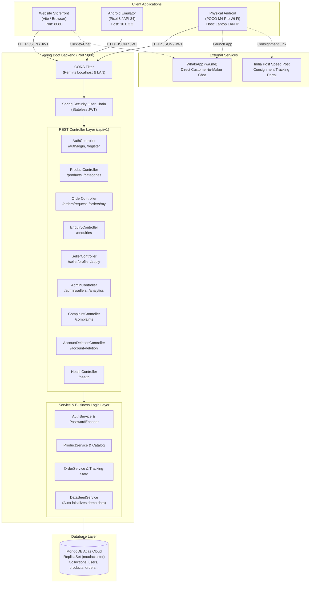

# MOOLA — Pure Indian Homemade Food Marketplace
> **From the Source. To Your Home.**


MOOLA is a dedicated direct-to-consumer (D2C) marketplace connecting discerning households across India with independent home food artisans, rural self-help groups (SHGs), smallholder farm families, and traditional cooks.

**Core Categories**:
- Small-batch jackfruit crisps & Kerala banana chips fried in pure wood-pressed coconut oil
- Wild raw multifloral forest honey from the Western Ghats (unpasteurized & unfiltered)
- Heritage sun-cured pickles (Appemidi tender mango, wild lime, green chilli in mustard & sesame oil)
- Hand-pounded regional masalas & aromatic whole spices (Byadgi chilli, Malabar black pepper, wild turmeric)
- Traditional homemade sweets, savouries, papads, and native millet flours
*(Strictly authentic homemade pantry food — not a fresh vegetable or grocery market)*

---

## Quick Navigation

- 📖 **Operational & Developer Guide**: 👉 **[SETUP_GUIDE.md](SETUP_GUIDE.md)** *(Complete PowerShell commands, Android Studio setup, POCO M4 Pro Wi-Fi debugging, port management, and troubleshooting)*.
- 🏛️ **System Architecture**: [Section 5](#5-system-architecture)
- 🔌 **REST API Specification**: [Section 7](#7-backend-api-reference)
- 🗺️ **Product Roadmap**: [Section 10](#10-future-product-roadmap)
- 📋 **Production Checklist**: [Section 12](#12-production-readiness--legal-checklist)

---

## 1. Project Overview

Modern urban households increasingly seek authentic, chemical-free, traditional homemade foods prepared using ancestral culinary wisdom. At the same time, rural home makers, women-led kitchen enterprises, and smallholders lack direct access to pan-India buyers without middleman exploitation or prohibitive marketplace commission fees.

MOOLA solves this by providing:
1. A **Native Android App** (Java & XML) tailored for Indian customers with clear regional typography, bilingual tags, and trust badges.
2. A **Lightweight Web Client** (Vite + Vanilla CSS) accessible from desktop and mobile browsers.
3. A **Robust Java Spring Boot Backend** (Spring Security + MongoDB Atlas) providing auditable order tracking, seller KYC management, and customer grievance ticketing.
4. **Direct Trust Channels**: Direct WhatsApp click-to-chat inquiry generation, direct maker UPI payment verification, and manual consignment tracking via India Post Speed Post.

---

## 2. Product Goals & User Experience

| User Persona | Implemented Verified Experience | Planned / Future Experience |
|---|---|---|
| **Connoisseur Buyer** | • Browse categorized homemade snacks & honey<br>• Debounced search & price/organic filtering<br>• View ingredient provenance & certifications<br>• Submit direct batch order requests<br>• WhatsApp click-to-chat with makers<br>• India Post consignment AWB tracking<br>• Submit transaction UTR reference<br>• In-app & web grievance ticket submission | • Automated Razorpay gateway checkout<br>• Live push notifications for order steps<br>• Customer photo & recipe reviews |
| **Artisan Maker (Seller)** | • Dedicated Maker Kitchen Dashboard<br>• Real-time product inventory counts<br>• Add/edit products (pricing, unit, stock)<br>• Review incoming customer orders<br>• Mark orders confirmed & record AWB tracking<br>• Verify buyer UPI UTR payments<br>• Onboarding KYC application submission | • Direct mobile camera photo uploads<br>• Automated Shiprocket pickup booking<br>• Payout settlement analytics |
| **Platform Administrator** | • Global marketplace metrics & analytics<br>• Review maker KYC applications (Approve / Reject)<br>• Moderate product listings & user statuses<br>• Manage customer grievance tickets (48h SLA)<br>• Process GDPR account deletion queue | • Automated seller sales commission billing<br>• Multi-agent support ticket routing |

---

## 3. Current Technology Stack

| Layer | Technology | Version / Toolchain | File Location |
|---|---|---|---|
| **Android Client** | Native Android (Java + XML) | Android SDK 34 (minSdk 26), Java 17 | [android-app/](android-app/) |
| **Android Libraries** | Retrofit 2, OkHttp 3, Gson, Glide, Material 3, ViewBinding | Gradle 9.2.0 Wrapper | [android-app/app/build.gradle](android-app/app/build.gradle) |
| **Backend REST API** | Java + Spring Boot | Spring Boot 3.3.4, Java 17 | [backend/](backend/) |
| **Security & Auth** | Spring Security 6, JJWT (HMAC-SHA256) | JJWT 0.12.6, BCrypt (strength 12) | [backend/src/.../config/](backend/src/main/java/com/moola/backend/config/) |
| **Database** | MongoDB Atlas (Cloud ReplicaSet) | Spring Data MongoDB 4.3.4 | [backend/src/.../repository/](backend/src/main/java/com/moola/backend/repository/) |
| **Backend Build Tools**| Gradle 9.2.0 Wrapper (`.\gradlew.bat`) & Maven (`pom.xml`) | JDK 17 to 25 compatible | [backend/build.gradle](backend/build.gradle) |
| **Web Storefront** | HTML5, Vanilla CSS3, ES6 JavaScript | Vite 5.4.8 dev server & bundler | [website/](website/) |
| **Archived History** | Node.js / Express prototype & React Native | Preserved in `legacy/` | [legacy/](legacy/) |

---

## 4. Complete Repository Structure

```
MOOLA/
├── README.md                      # Master Product & Technical Architecture Reference (This file)
├── SETUP_GUIDE.md                 # Master Developer Operational Guide (Windows 11, PowerShell, ADB)
├── .gitignore                     # Git ignore rules for Android, Java, Vite, and secrets
├── moola logo.png                 # High-resolution master brand logo asset
├── organic_marketplace_blueprint (1).pdf # Foundational product requirements reference
│
├── android-app/                   # Native Android Studio Project (Pure Java + XML)
│   ├── build.gradle               # Root Android build configuration
│   ├── settings.gradle            # Module declarations (`:app`)
│   ├── gradle.properties          # AndroidX & Jetifier flags
│   ├── gradlew.bat / gradlew      # Official Gradle 9.2.0 wrapper (auto-detects JBR)
│   └── app/
│       ├── build.gradle           # SDK 34, ViewBinding, Retrofit, Glide, Material 3
│       └── src/
│           ├── main/
│           │   ├── AndroidManifest.xml # Permissions, activities, Network Security config
│           │   ├── java/com/moola/app/
│           │   │   ├── adapter/   # RecyclerView adapters (Product, Category, Order, etc.)
│           │   │   ├── data/
│           │   │   │   ├── api/   # ApiClient (Retrofit), MoolaApiService
│           │   │   │   ├── model/ # Domain models (User, Product, Order, Complaint, etc.)
│           │   │   │   └── storage/ # SessionManager (SharedPreferences for JWT)
│           │   │   └── ui/        # Native Activities & Fragments (Auth, Home, Order, Admin)
│           │   └── res/
│           │       ├── drawable/  # Authentic brand logo, chocolate gradients, badges
│           │       ├── layout/    # 22 responsive XML screen layouts
│           │       ├── values/    # colors.xml (Brand tokens), themes.xml, strings.xml
│           │       └── xml/       # network_security_config.xml (Cleartext local testing)
│           └── test/              # Local JVM unit tests (ExampleUnitTest.java)
│
├── backend/                       # Spring Boot 3.3.4 Production Backend
│   ├── pom.xml                    # Canonical Maven configuration
│   ├── build.gradle               # Canonical Gradle configuration (supports Java 17-25)
│   ├── settings.gradle            # Gradle project name (`moola-backend`)
│   ├── gradlew.bat / gradlew      # Official Gradle wrapper for terminal execution
│   ├── .env.example               # Safe environment variable template (no credentials)
│   └── src/
│       ├── main/
│       │   ├── java/com/moola/backend/
│       │   │   ├── MoolaBackendApplication.java # Spring Boot entry point
│       │   │   ├── config/        # SecurityConfig, JwtTokenProvider, JwtAuthFilter
│       │   │   ├── controller/    # 10 REST Controllers (Auth, Product, Order, Admin, etc.)
│       │   │   ├── dto/           # Request/Response contracts with Jakarta Validation
│       │   │   ├── exception/     # GlobalExceptionHandler, ResourceNotFoundException
│       │   │   ├── model/         # MongoDB documents (User, Product, Order, Complaint, etc.)
│       │   │   ├── repository/    # Spring Data MongoRepository interfaces
│       │   │   └── service/       # Business services & DataSeedService (demo seeder)
│       │   └── resources/
│       │       └── application.properties # Server port 5000, Atlas URI, JWT configuration
│       └── test/                  # Backend unit tests (JUnit 5 Platform)
│
├── website/                       # Standalone Responsive Web Client
│   ├── index.html                 # Main Storefront (Hero banner, categories, product grid)
│   ├── seller.html                # Maker onboarding application & KYC submission
│   ├── complaints.html            # Customer care grievance submission (48h SLA)
│   ├── account-deletion.html      # Public GDPR account deletion request page
│   ├── package.json               # npm scripts (`dev`, `build`, `preview`)
│   ├── .env.example               # Vite environment template
│   ├── css/
│   │   └── styles.css             # Vanilla CSS design system matched to brand logo
│   ├── js/
│   │   ├── api.js                 # Frontend REST client connecting to backend port 5000
│   │   └── app.js                 # Storefront UI interactions & modal logic
│   └── assets/                    # Optimized brand logo asset
│
├── legacy/                        # Safely Preserved Historical Prototypes
│   ├── apps/
│   │   ├── mobile/                # Preserved React Native / Expo prototype
│   │   └── server/                # Preserved Node.js / Express prototype
│   └── packages/shared/           # Preserved shared TypeScript interfaces
│
└── docs/                          # Static Reference Media
    └── logo.png                   # High-resolution brand logo asset
```

### Where to Edit Code by Feature

| Feature / Task | Files to Edit |
|---|---|
| **Android App Screens & UI** | Layouts: [android-app/.../res/layout/](android-app/app/src/main/res/layout/)<br>Activities: [android-app/.../ui/](android-app/app/src/main/java/com/moola/app/ui/) |
| **Android API & Backend URL** | [android-app/.../ApiClient.java](android-app/app/src/main/java/com/moola/app/data/api/ApiClient.java#L20) |
| **Android Colors & Theme** | [colors.xml](android-app/app/src/main/res/values/colors.xml) & [themes.xml](android-app/app/src/main/res/values/themes.xml) |
| **Backend REST Endpoints** | [backend/.../controller/](backend/src/main/java/com/moola/backend/controller/) |
| **Backend Business Logic** | [backend/.../service/](backend/src/main/java/com/moola/backend/service/) |
| **Backend Security & Routes** | [backend/.../SecurityConfig.java](backend/src/main/java/com/moola/backend/config/SecurityConfig.java) |
| **Backend Database Config** | [application.properties](backend/src/main/resources/application.properties) |
| **Website Pages & Forms** | [website/index.html](website/index.html), [seller.html](website/seller.html), [complaints.html](website/complaints.html) |
| **Website Styles & Branding**| [website/css/styles.css](website/css/styles.css) |
| **Website API Requests** | [website/js/api.js](website/js/api.js) |

---

## 5. System Architecture



---

## 6. Feature Inventory & Implementation Status

| Feature / Workflow | Status | Description |
|---|---|---|
| **User Registration & Login** | ✅ **Implemented & Verified** | Phone number (Indian 10-digit) + password authentication with BCrypt hashing and JWT tokens. |
| **Role-Based Access Control** | ✅ **Implemented & Verified** | Strictly enforced in backend: `ROLE_BUYER`, `ROLE_SELLER`, `ROLE_ADMIN`. |
| **Product Discovery & Search** | ✅ **Implemented & Verified** | Category pill navigation, keyword search, price filtering, organic badge display. |
| **Direct Order Request** | ✅ **Implemented & Verified** | Buyer creates direct order with shipping address; maker confirms batch; buyer submits UTR. |
| **Consignment AWB Tracking** | ✅ **Implemented & Verified** | Maker logs India Post Speed Post AWB number; buyer views direct tracking link. |
| **WhatsApp Inquiries** | ✅ **Implemented & Verified** | Structured `wa.me/<phone>?text=...` message generation; logged in MongoDB for audit. |
| **Maker Kitchen Dashboard** | ✅ **Implemented & Verified** | Maker sees active listings, incoming orders, and can publish new homemade food products. |
| **Maker KYC Verification** | ✅ **Implemented & Verified** | Maker submits shop name, FSSAI number, and UPI ID; Admin reviews and approves in Admin portal. |
| **Customer Grievance SLA** | ✅ **Implemented & Verified** | In-app and web ticket submission (`TKT-YYYYMMDD-XXXX`) with 48-hour response target. |
| **GDPR Account Deletion** | ✅ **Implemented & Verified** | In-app flow and standalone public webpage (`/account-deletion.html`) complying with Play Console. |
| **Automated Payment Gateway** | ⚪ **Planned (Future Scope)** | Direct UPI transfer and manual UTR verification are used currently to avoid gateway fees. |
| **Automated 3PL Courier API** | ⚪ **Planned (Future Scope)** | India Post Speed Post manual consignment logging is used currently. |

---

## 7. Backend API Reference

The backend runs on port **5000**. All API endpoints are prefixed with `/api/v1` (with `/api/health` aliased for monitoring).

| Method | Endpoint | Authorization | Description |
|---|---|---|---|
| `POST` | `/api/v1/auth/register` | Public | Register a new customer (`buyer`) or artisan maker (`seller`). |
| `POST` | `/api/v1/auth/login` | Public | Authenticate with phone & password; returns JWT access token. |
| `POST` | `/api/v1/auth/refresh` | Public | Refresh expired access token using refresh token. |
| `GET` | `/api/v1/auth/me` | Authenticated | Retrieve current user profile and role details. |
| `GET` | `/api/v1/health` or `/api/health` | Public | Health check returning status `UP`. |
| `GET` | `/api/v1/products` | Public | Search products with query `q`, `category`, `minPrice`, `maxPrice`, `sort`. |
| `GET` | `/api/v1/products/{id}` | Public | Detailed product view with artisan maker kitchen profile. |
| `POST` | `/api/v1/products` | Maker (`SELLER`) | Publish a new homemade food product listing. |
| `PATCH`| `/api/v1/products/{id}` | Maker / Admin | Update product stock, pricing, or description. |
| `DELETE`| `/api/v1/products/{id}`| Maker / Admin | Remove listing from catalog. |
| `GET` | `/api/v1/categories` | Public | List all 8 pantry categories with icons. |
| `POST` | `/api/v1/orders/request` | Authenticated | Submit direct order request to an artisan maker. |
| `GET` | `/api/v1/orders/my` | Buyer | List buyer's active and fulfilled orders. |
| `GET` | `/api/v1/orders/seller` | Maker (`SELLER`) | List incoming orders received by maker's kitchen. |
| `GET` | `/api/v1/orders/{id}` | Authenticated | Order details, payment status, and consignment AWB. |
| `POST` | `/api/v1/orders/{id}/confirm` | Maker | Confirm batch preparation. |
| `POST` | `/api/v1/orders/{id}/shipment`| Maker | Record courier/Speed Post AWB tracking number. |
| `PATCH`| `/api/v1/orders/{id}/verify-payment` | Maker | Confirm receipt of UPI transfer. |
| `POST` | `/api/v1/orders/{id}/utr` | Buyer | Submit transaction UTR reference. |
| `POST` | `/api/v1/enquiries` | Public / Buyer | Log customer WhatsApp click-to-chat inquiry. |
| `GET` | `/api/v1/seller/profile` | Maker | Retrieve kitchen profile, UPI ID, and KYC status. |
| `POST` | `/api/v1/seller/apply` | Authenticated | Submit maker onboarding KYC application. |
| `GET` | `/api/v1/admin/analytics` | Admin | Overall marketplace counts (buyers, makers, products). |
| `GET` | `/api/v1/admin/sellers` | Admin | List maker KYC applications. |
| `PUT` | `/api/v1/admin/sellers/{id}/kyc` | Admin | Review maker KYC (Approve / Reject). |
| `POST` | `/api/v1/complaints` | Authenticated | File grievance ticket (48h response SLA). |
| `GET` | `/api/v1/complaints/my` | Buyer | Track status of user's filed grievance tickets. |
| `POST` | `/api/v1/account-deletion/request` | Authenticated | Request permanent account erasure and PII scrub. |
| `POST` | `/api/v1/account-deletion/public-request` | Public | Web-based deletion request (Play Console requirement). |

---

## 8. Client Development API Base URLs

| Client Platform | Development Base URL | Explanation |
|---|---|---|
| **Website (Laptop Browser)** | `http://localhost:5000/api/` | Connects directly on the same computer. |
| **Android Studio Emulator** | `http://10.0.2.2:5000/api/` | Standard emulator virtual network address mapping to host machine's `127.0.0.1`. |
| **Physical Phone (POCO M4 Pro)** | `http://<YOUR-LAN-IP>:5000/api/` | Physical devices cannot resolve `localhost` or `10.0.2.2`. Use your laptop's Wi-Fi IP (e.g. `192.168.1.40`). |
| **Production Server** | `https://api.moola.com/api/` | Future deployed domain with SSL certificate. |

---

## 9. Authentication & Security Model

- **Stateless Tokens**: The backend issues JWT tokens signed with HMAC-SHA256. Tokens are passed in the HTTP header:  
  `Authorization: Bearer <token>`.
- **Authoritative Backend Security**: Selecting a role on the frontend does **not** grant permissions. Permissions are evaluated on every request by Spring Security's `@PreAuthorize` annotations based on claims extracted from the verified JWT.
- **Password Security**: Passwords are never stored in plaintext; they are hashed using BCrypt with a cost factor of 12.
- **CORS Protection**: The backend allows requests from `localhost`, `127.0.0.1`, and local private IP ranges (`192.168.*`) in development.

---

## 10. Future Product Roadmap

```
+---------------------------------------------------------------------------------------+
| PHASE 1: Reliable Local Setup & Zero-Config Tooling (COMPLETED)                       |
|   • Gradle 9.2.0 wrapper in backend & android-app                                      |
|   • Automated Java runtime (JBR) fallback                                             |
|   • Single-page documentation consolidation (README.md & SETUP_GUIDE.md)              |
+---------------------------------------------------------------------------------------+
| PHASE 2: Core Marketplace Workflows (COMPLETED)                                       |
|   • Buyer product discovery, search, and direct order requests                         |
|   • Artisan maker dashboard, listing management, and order fulfillment                |
|   • Admin analytics, KYC verification, and grievance ticketing                        |
+---------------------------------------------------------------------------------------+
| PHASE 3: POCO M4 Pro & Physical Device Testing (COMPLETED)                            |
|   • Network Security Configuration for cleartext LAN debugging                        |
|   • Dynamic base URL support in ApiClient.java                                        |
|   • Wireless debugging guide & Windows Firewall documentation                         |
+---------------------------------------------------------------------------------------+
| PHASE 4: Automated 3PL Shipping & Webhooks (PLANNED)                                  |
|   • Automated Shiprocket / Delhivery AWB generation                                   |
|   • Webhook ingestion for real-time delivery status updates                           |
+---------------------------------------------------------------------------------------+
| PHASE 5: Automated Payment Gateway (PLANNED)                                          |
|   • Razorpay / Cashfree escrow integration                                            |
|   • Automated refund handling                                                         |
+---------------------------------------------------------------------------------------+
```

---

## 11. Testing & Quality Verification

All components have automated test suites executed via standard commands:

| Component | Test Command | Verified Result |
|---|---|---|
| **Backend Unit Tests** | `cd backend && .\gradlew.bat test` | **PASSED** (JUnit 5 Platform runner) |
| **Android Unit Tests** | `cd android-app && .\gradlew.bat testDebugUnitTest` | **PASSED** (Local JVM unit tests) |
| **Android APK Assembly**| `cd android-app && .\gradlew.bat assembleDebug` | **PASSED** (Generates 8.89 MB APK) |
| **Website Bundle** | `cd website && npm run build` | **PASSED** (Vite builds bundle in <1s) |

---

## 12. Production Readiness & Legal Checklist

Before publishing to Google Play Console or public domains:

- [ ] **FSSAI Compliance**: Verify that all onboarding food makers hold valid FSSAI registration numbers.
- [ ] **Food Labelling**: Ensure product packaging includes shelf-life, batch numbers, storage instructions, and allergen declarations.
- [ ] **Legal Entity**: Insert official registered business name and physical registered office address into website terms.
- [ ] **Account Deletion**: Ensure public deletion URL (`https://<domain>/account-deletion.html`) is accessible without login (Play Store requirement).
- [ ] **SSL / HTTPS**: Enforce HTTPS on production backend and website domains.
- [ ] **APK Release Signing**: Generate a production release keystore and configure `signingConfigs` in `android-app/app/build.gradle`.

---

## 13. How to Run the Project

For complete step-by-step instructions, open:  
👉 **[SETUP_GUIDE.md](SETUP_GUIDE.md)**
