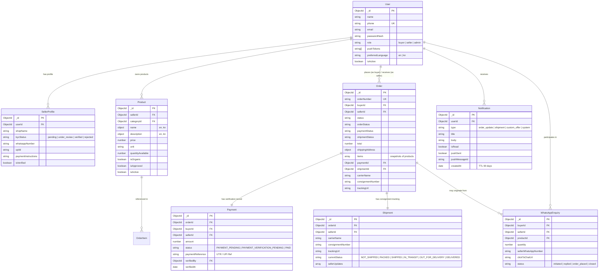
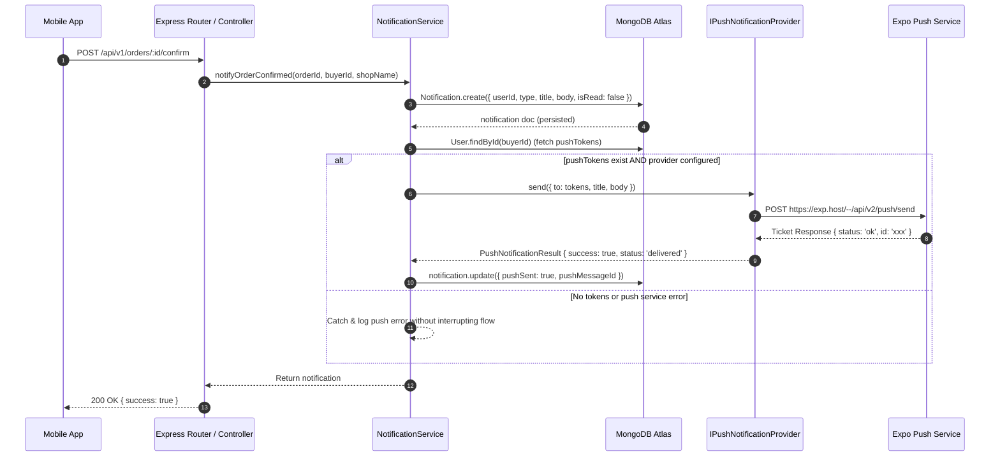

# MOOLA — System Architecture & Technical Specifications

**Document Version**: 1.0.0  
**Last Updated**: October 22, 2026  
**Project**: MOOLA — *From the Source. To Your Home.*  
**System Type**: Direct-to-Consumer (D2C) Organic Foods & Homemade Products Marketplace  

---

## 1. High-Level Architecture Overview

MOOLA is architected as a TypeScript monorepo with clean separation between shared domain models, a scalable Node.js/Express backend API, and a cross-platform React Native / Expo mobile application. MongoDB Atlas serves as the single source of truth for all operational data.

```mermaid
graph TB
    subgraph MobileApp ["Mobile Frontend (apps/mobile)"]
        UI_Buyer[Buyer UI: Home, Detail, Cart, Orders, Tracking, Notifications]
        UI_Seller[Seller UI: Dashboard, Add Product, Orders, Consignment Modal]
        UI_Admin[Admin UI: Overview, KYC Verification, Order Moderation]
        MobileAPI[Mobile API Service Layer (services/api.ts)]
        MobileNotif[Mobile Notification Service (services/notificationService.ts)]

        UI_Buyer --> MobileAPI
        UI_Seller --> MobileAPI
        UI_Admin --> MobileAPI
        UI_Buyer --> MobileNotif
        MobileNotif --> MobileAPI
    end

    subgraph BackendAPI ["Backend API (apps/server)"]
        RouterLayer[Express Routes (src/routes/*)]
        AuthMiddleware[Auth & RBAC Middleware (middleware/auth.ts)]
        ControllerLayer[Controllers (src/controllers/*)]
        NotifDispatcher[Notification Service (services/notifications/notificationService.ts)]
        PushAbstraction[IPushNotificationProvider]
        ExpoPushClient[ExpoPushNotificationProvider]

        RouterLayer --> AuthMiddleware
        AuthMiddleware --> ControllerLayer
        ControllerLayer --> NotifDispatcher
        NotifDispatcher --> PushAbstraction
        PushAbstraction --> ExpoPushClient
    end

    subgraph Database ["Primary Database (MongoDB Atlas)"]
        MongoUsers[(Users & SellerProfiles)]
        MongoProducts[(Products & Categories)]
        MongoOrders[(Orders, Payments, Shipments)]
        MongoEnquiries[(WhatsAppEnquiries)]
        MongoNotifs[(Notifications)]

        ControllerLayer --> MongoUsers
        ControllerLayer --> MongoProducts
        ControllerLayer --> MongoOrders
        ControllerLayer --> MongoEnquiries
        ControllerLayer --> MongoNotifs
        NotifDispatcher --> MongoNotifs
    end

    subgraph ExternalServices ["External Services"]
        WA["WhatsApp Click-to-Chat (wa.me)"]
        Carriers["India Post / Courier Portals (DTDC, Blue Dart)"]
        ExpoPushSvc["Expo Push Notification Service (exp.host)"]

        UI_Buyer -.->|Launch App| WA
        UI_Buyer -.->|Direct Tracking Link| Carriers
        ExpoPushClient -.->|HTTP POST Payload| ExpoPushSvc
    end

    MobileAPI -->|REST API over HTTPS / JWT| RouterLayer
```

---

## 2. Monorepo Structure & Package Boundaries

The repository is organized into three distinct workspace packages:

```
d:/Moola-App/
├── apps/
│   ├── mobile/         # React Native + Expo SDK 51 + TypeScript
│   └── server/         # Node.js + Express.js + Mongoose + TypeScript
├── packages/
│   └── shared/         # Canonical types, enums, constants, utilities
├── docs/               # Technical documentation & architecture specifications
├── .gitignore          # Root-level ignore rules
└── package.json        # Workspace orchestrator
```

### 2.1 Workspace Dependencies & Responsibilities

| Package | Name | Primary Responsibilities |
| :--- | :--- | :--- |
| `packages/shared` | `@moola/shared` | Canonical status enums (`OrderStatus`, `PaymentStatus`, `ShipmentStatus`), TypeScript interfaces (`Product`, `Order`, `Shipment`, `Notification`), carrier tracking URL generators, WhatsApp link and template builders. Zero runtime dependencies. |
| `apps/server` | `@moola/server` | Express REST API, MongoDB Atlas Mongoose connection with masked logging, JWT authentication, role authorization, business rule validation, order state transitions, consignment tracking, and in-app/push notification dispatching. |
| `apps/mobile` | `@moola/mobile` | React Native mobile application for buyers, sellers, and administrators. Multilingual UI (English and Kannada), offline-resilient API communication, manual product listing, WhatsApp click-to-chat, tracking screens, and Notification Center. |

---

## 3. Database Schema & Data Relationships

All collections reside in MongoDB Atlas (`MOOLACluster`). MongoDB Atlas is the exclusive primary database; no Firebase Authentication or Firebase Realtime Database is introduced.



---

## 4. Core Workflow Specifications

### 4.1 Product Enquiry via WhatsApp
To preserve buyer trust and direct communication without claiming automated message delivery:
1. Buyer navigates to a product detail screen on mobile.
2. Tapping **"Enquire via WhatsApp"** calls `POST /api/v1/enquiries` to safely record the intent in MongoDB Atlas.
3. The server validates the seller's phone number and builds a standard WhatsApp URL:
   `https://wa.me/<seller_phone>?text=<encoded_message>`
4. The mobile app opens the URL via React Native `Linking.openURL()`.
5. The enquiry record is flagged as `status: 'initiated'`.

### 4.2 Order Lifecycle & Decoupled State Machine
Orders follow a verified state machine. Payment status is decoupled from shipment status:

```
[ ORDER_REQUESTED ] ──(Seller Confirms)──> [ ORDER_CONFIRMED ]
         │                                         │
  (Seller Declines)                         (Buyer Submits UTR)
         │                                         │
         ▼                                         ▼
   [ CANCELLED ]                     [ PAYMENT_VERIFICATION_PENDING ]
                                                   │
                                            (Seller Verifies)
                                                   │
                                                   ▼
                                            [ PAID & VERIFIED ]
                                                   │
                                            (Seller Dispatches)
                                                   │
                                                   ▼
                                            [ SHIPPED / IN_TRANSIT ]
                                                   │
                                            (Carrier Delivers)
                                                   │
                                                   ▼
                                            [ DELIVERED ]
```

- **Order Item Snapshotting**: When an order is placed, an immutable snapshot of each product (`OrderItemSnapshot`) is stored inside the order document. Price or description edits by the seller never distort past orders.
- **Stock Reservation**: Available inventory is automatically deducted upon order request and restored if the order is cancelled or declined.

### 4.3 Manual Courier & India Post Tracking
In this release, automated courier APIs (Shiprocket/Delhivery) are intentionally not engaged. Instead:
1. Seller packages goods and obtains a consignment/AWB receipt from India Post, DTDC, Blue Dart, etc.
2. Seller navigates to **Seller Orders** in the mobile app, opens the **Consignment Modal**, and inputs:
   - Courier/Postal Service Name (India Post, DTDC, Professional Couriers, Blue Dart, Other)
   - Consignment / AWB / Tracking Number
   - Dispatch Date & Notes
3. The server generates a verified tracking link using pre-approved carrier URL templates (`CARRIER_TRACKING_TEMPLATES`).
4. A `Shipment` record is created, the order status transitions to `SHIPPED`, and an in-app notification is dispatched to the buyer.
5. The buyer's **Order Tracking Screen** displays a prominent notice: *"Tracking updates are seller-provided. Click below to verify consignment progress directly with the carrier."*

---

## 5. Notification Architecture



### Key Security & Reliability Guarantees:
- **Resilience**: Push notification failure never halts database updates, order confirmations, or payment verification.
- **Provider Abstraction**: Swappable via `IPushNotificationProvider`. Switch between `ExpoPushNotificationProvider` and `MockPushNotificationProvider` without changing business controllers.
- **Atlas-First**: In-app notifications are stored primarily in MongoDB Atlas with a 90-day TTL index.
- **Zero Secret Exposure**: No FCM private keys or APNs certificates are stored in source code or sent to the mobile client.
